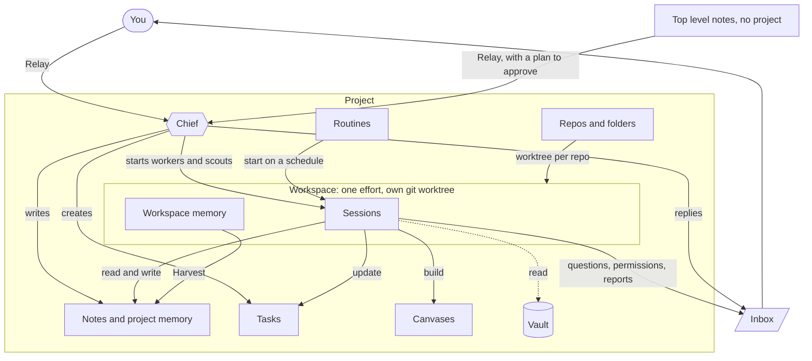
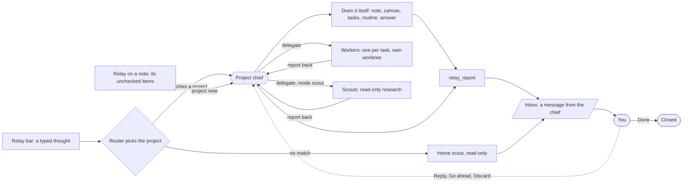
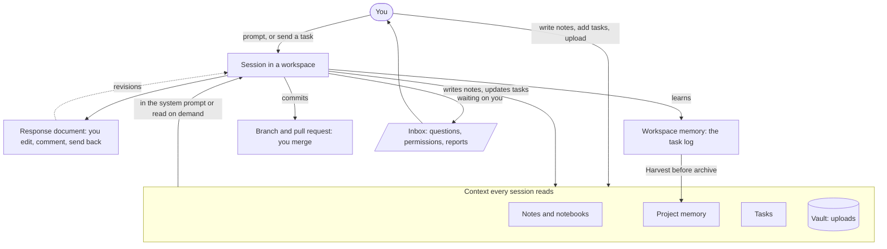

# How Thunk works

Three pictures: what exists, what happens when you hand work off, and how what you write reaches agents and comes back. The first-run intro (Settings → Help → Show intro) covers the same ground in four screens.

## 1. Objects: what exists and what owns what

- A **project** owns everything else: repos and folders, notes and project memory, tasks, canvases, routines and the Vault.
- A **workspace** is one effort inside a project, with its own git worktree. A **session** is one chat inside a workspace. An automatic workspace releases its worktree after a day idle with no unmerged work, and comes back at the same path.
- The **chief** is the one session in each project that coordinates. It never edits code. It makes notes, canvas content, tasks, workspaces and routines, and starts workers and scouts. See [Project chiefs and workers](../README.md#project-chiefs-and-workers).
- **Top level** notes belong to no project.
- The **Inbox** is where everything that needs you lands, across projects.

## 2. Relay to Inbox: what happens when you hand something off

- **Relay a thought:** type it into the Relay bar (or press its shortcut on any page). A router picks the project and hands the thought to that project's chief. `#project` in the text picks the project yourself.
- **Relay a note:** on a project note, **Relay** sends its unchecked `- [ ]` items to that project's chief, which turns each into a task.
- **What the chief does:** it either does the thing itself (a note, something on a canvas, tasks, a routine, an answer) or delegates to workers and scouts, who report back to it. A relay counts as your go-ahead, so it can start several workers without asking first. Four workers run at a time per project; extra tasks queue.
- **Coming back to you:** the chief settles the relay with `relay_report`, and it arrives in your Inbox as a message from that chief. **Reply** sends the chief a message and the card returns when it answers, with the whole exchange on it. **Done** closes it, **Go ahead** approves one step the chief held back, and **Open the chief** goes to its session.
- Nothing merges, pushes or deploys on its own.

Details: [Relay](capture.md).

## 3. Context loop: how what you write reaches agents and comes back

- Project memory and notes marked **In session context** go into every new session's system prompt. Other notes are listed by path and read on demand. Agents can read Vault items and can write notes, memory and tasks.
- An assistant's final prose becomes a **document** you edit or comment on and send back. Plans follow the same flow.
- **Harvest** moves what a workspace learned into project memory before the workspace is archived or deleted.

## Current limits

- A thought that matches no project has no chief to go to. It runs as a read-only scout in Home, and its Inbox card is the older one (You said, Assumed, Did).
- Relay on a **top-level** note adds a step the second diagram leaves out: a Relay plan you approve in the Inbox before items reach each project's chief.
- A reply to the chief is not instant. It is a message the chief answers on its next turn; for a live back-and-forth, open its session.
- If the chief goes idle for five minutes with nothing running or queued and no `relay_report`, the thought is marked failed with Retry.
- A chief-handled thought shows no cost, because the chief's spend is not attributed to it.
- A chief cannot edit files, delete things, upload to the Vault, change project settings or act in another project.
